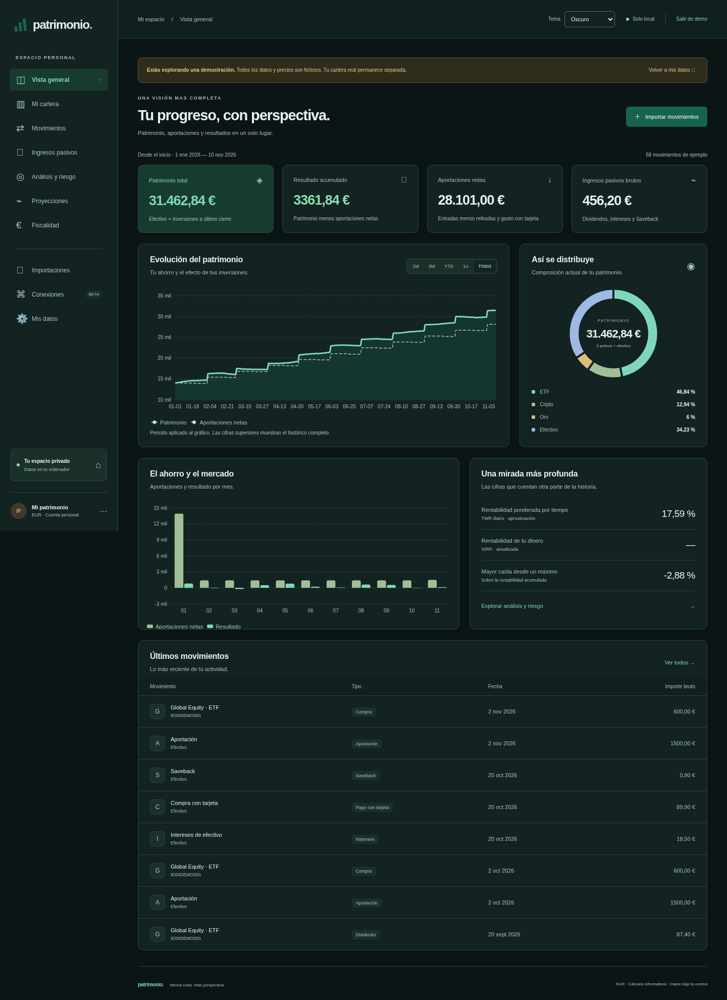
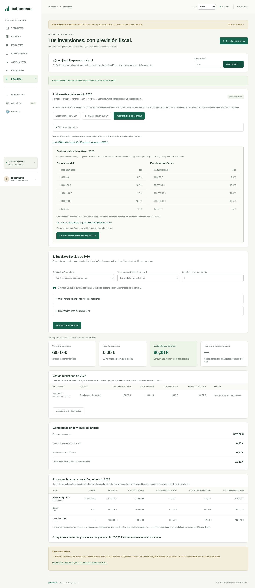
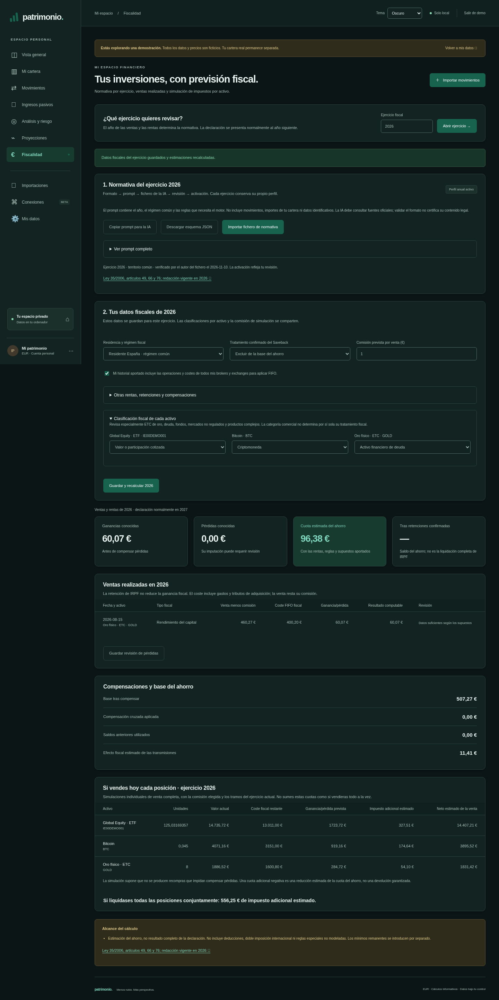
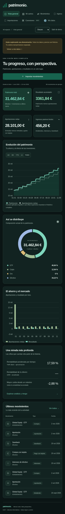

# Capturas de la aplicación

Capturas reales de la versión local en Chromium, tomadas el 10 de noviembre de 2026. Todos los importes y movimientos corresponden a la demo ficticia. No se ha conectado una cuenta bancaria ni se han simulado resultados de una sincronización real.

Escritorio: 1440 px de ancho. Móvil: 390 px. Las capturas muestran la página completa; las tablas pueden desplazarse horizontalmente en pantallas pequeñas.

## Vista general

## Cartera

## Análisis y riesgo

## Importaciones

## Conexiones y job periódico

La demo no está autenticada: la captura muestra los controles y el estado sin conectar, sin inventar ejecuciones ni movimientos del broker.

## Vista móvil

## Modo noche

El selector de la barra superior conserva la elección y también permite seguir el tema del sistema.

## Normativa fiscal por ejercicio

Importación y revisión del JSON anual. Los números del perfil y las clasificaciones usadas en estas capturas pertenecen a un caso de prueba, no a la cuenta del propietario. En la demo se clasificó el ETC ficticio como deuda para mostrar el cálculo; un producto real exige revisar su naturaleza fiscal.

## Estimación fiscal y simulación por activo

## Modo noche en móvil

