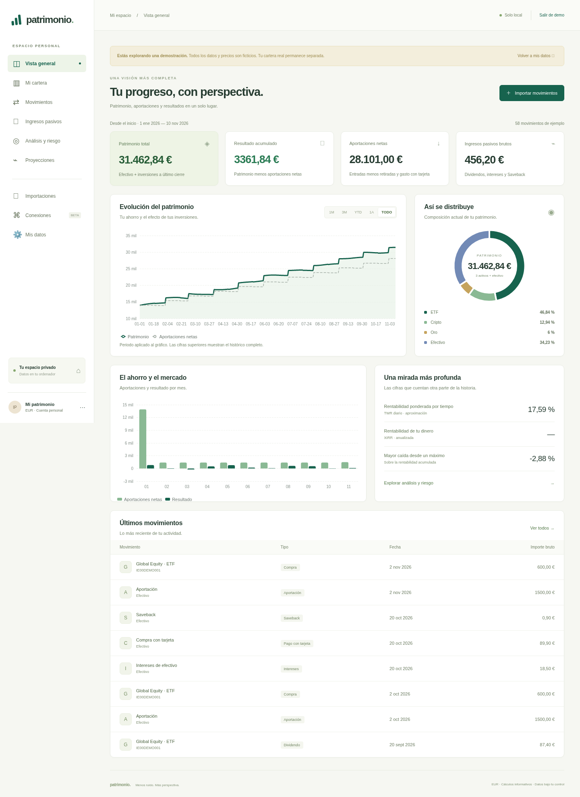
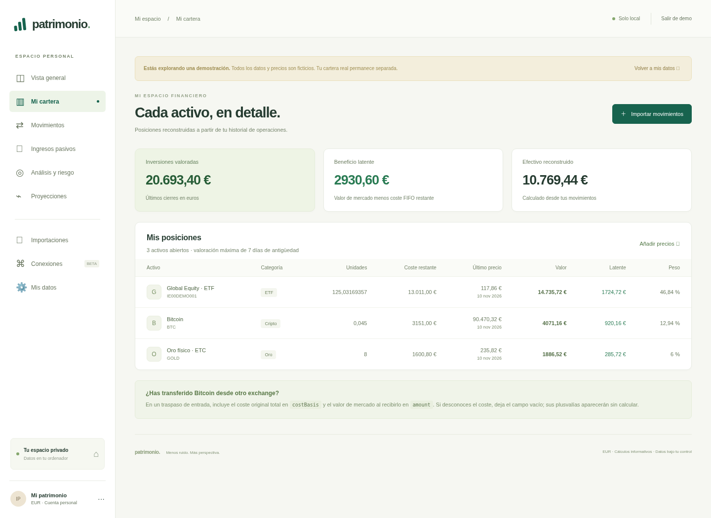
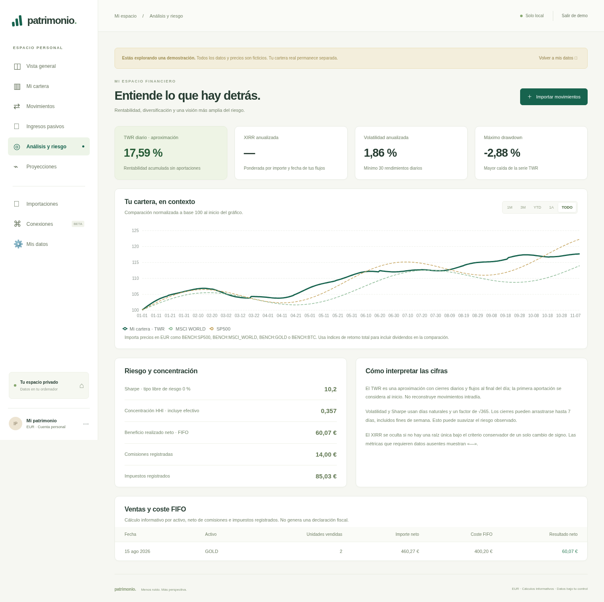
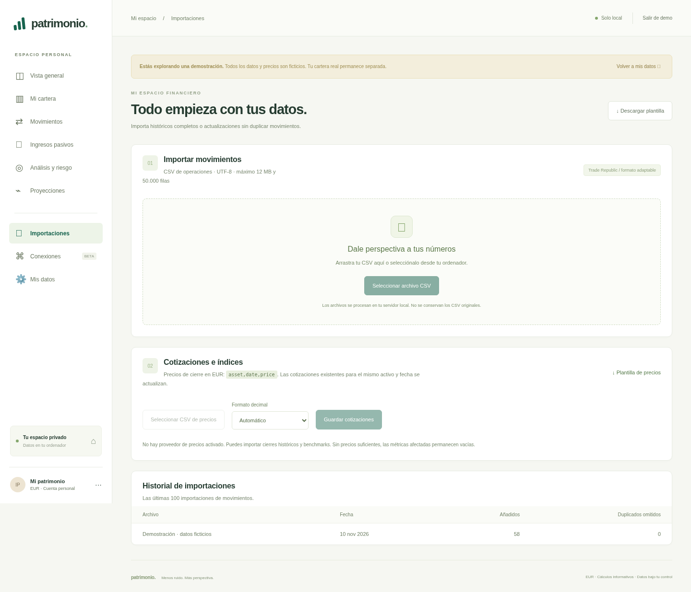
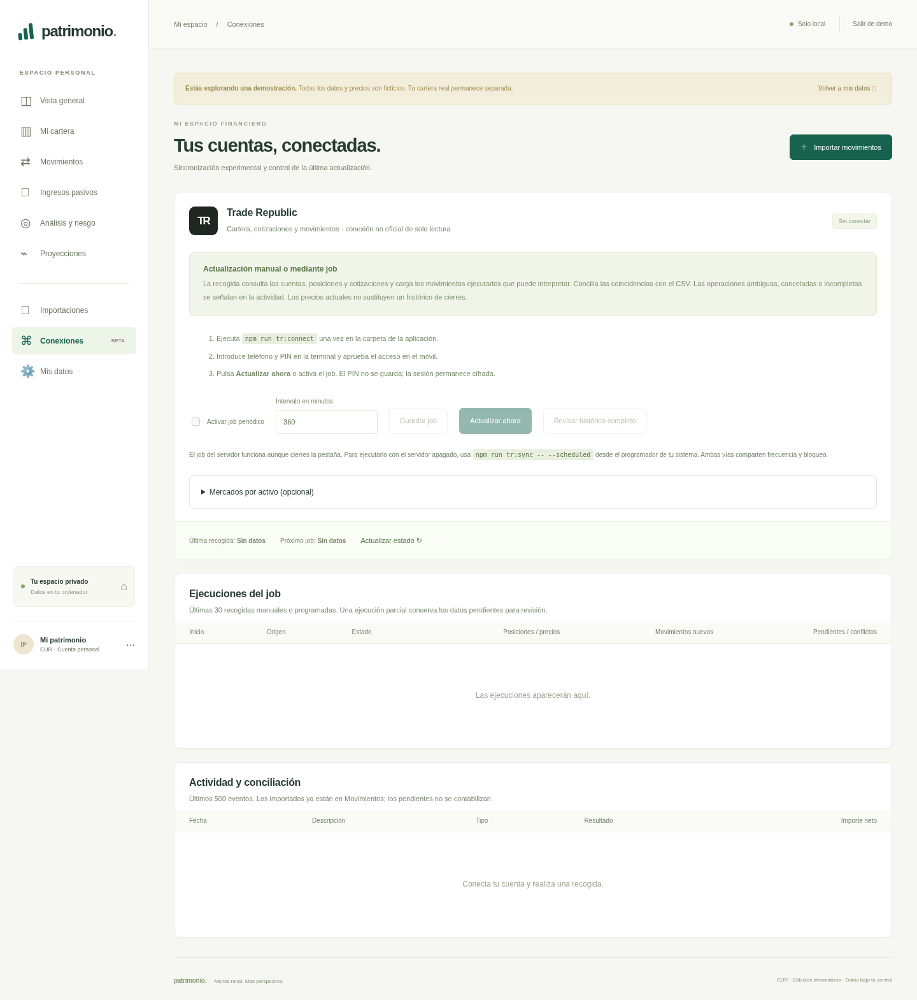
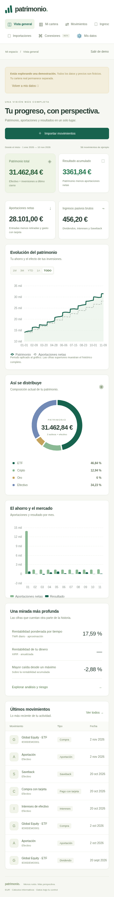

# Capturas de la aplicación

Capturas reales de la versión local en Chromium, tomadas el 10 de noviembre de 2026. Todos los importes y movimientos corresponden a la demo ficticia. No se ha conectado una cuenta bancaria ni se han simulado resultados de una sincronización real.

Escritorio: 1440 px de ancho. Móvil: 390 px. Las capturas muestran la página completa; las tablas pueden desplazarse horizontalmente en pantallas pequeñas.

## Vista general

## Cartera

## Análisis y riesgo

## Importaciones

## Conexiones y job periódico

La demo no está autenticada: la captura muestra los controles y el estado sin conectar, sin inventar ejecuciones ni movimientos del broker.

## Vista móvil

